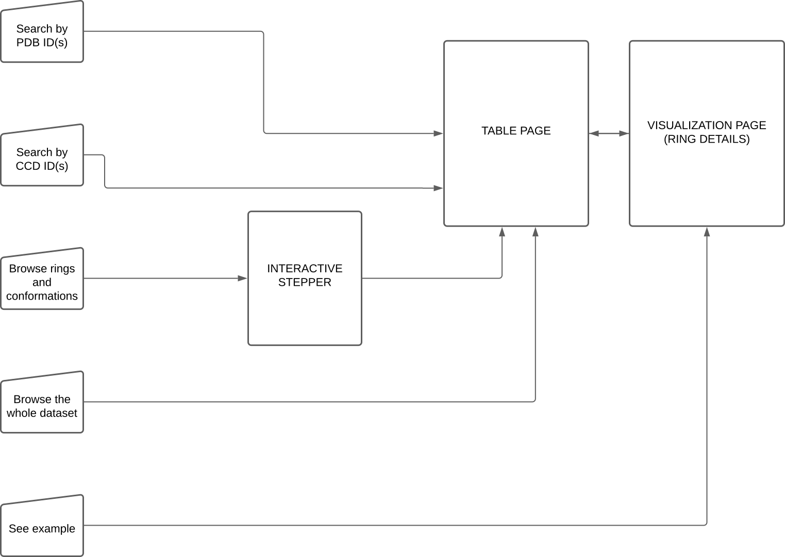

# Application User Guide

Welcome to the user guide for **RingWeb**.  
This guide will help you navigate and use the main features of the application.

---

## Main Page

### Overview

On the Main page you can choose where to start. There are four main options, each of which will bring you to the Table page, where you can browse rings and access its visualization. No option will limit your search, so you can start basically anywhere.

1. searching for rings in the chosen structure(s) from PDB. Multiple PDB IDs must be separated by comma, semicolon, or space. PDB ID can be lowercase or uppercase.
2. searching for rings in the chosen ligand(s) from PDB strucutres. Multiple CCD (ligand) IDs must be separated by comma, semicolon, or space. CCD ID can be lowercase or uppercase.
3. browsing available rings and their conformations. The application will guide you through simple stepper, where you can see how each conformation look like and then you can browse the data for selected combination of ring and conformation(s).
4. browsing the whole dataset directly, you will get to the Table Page, where are many options for data filtering and access to visualization for individual rings.

From the Main page you can also directly access the Visualization page of example rings.

---

## Table Page

### Overview

The Table Page displays structured data in an interactive table format. You can:

- Apply basic and advanced filters
- Sort columns
- Download data in CSV format
- Access the Visualization page

### How to Use

- You can start filter the dataset by selecting ring type or/and conforamtion.The same result can be achieved through entering the page via interactive stepper form the main page (Browse rings and conformations).
- On the top right toolbar of the table you can:
  - turn on the advanced filters mode to see two more levels of filters.
  - turn on the table compact view if you are not interested in viewing Experimental method, RSR and RSCC values.
  - download the selected data in CSV format.
- The total number of selected rings can be seen on the bottom toolbar of the table where you can also set your preferred rows per page count.
- With advanced filters mode on you can continue filtering by PDB IDs, CCD IDs and experimantal method. First two filters function as autocomplete after typing two characters. If you want to enter multiple PDB or CCD IDS, it is possible via direct input field from the Main page.
- At this stage if you want to make changes in the filter level above (ring type and conformation), the whole second row of filters will be reset. If you set filters in the last row and then make changes in filters above, everything below will be reset.
- Third level of filters allows you to set min and max values for individual values. You can also reset these slider values only.
- Click on a table row to view detailed information.
- Click on the action button (Details column) on each row to navigate to Visualization page and get more detailed information about selected ring.Preview the 2D structure of the ligand by right-click on the same button.

---

## Visualization Page

### How to Use

- Access the Ring Details Page via the table or via example cards from the homepage.
- Interact with the ring using the Mol* 3D Viewer.
- Toggle electron density maps to evaluate model fit.
- Download the structure in CIF format.
